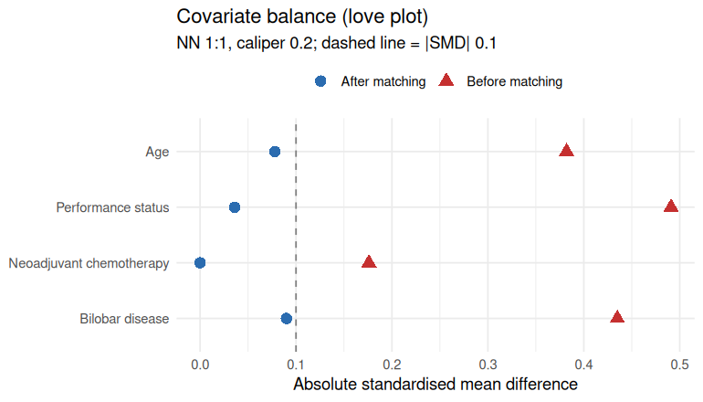
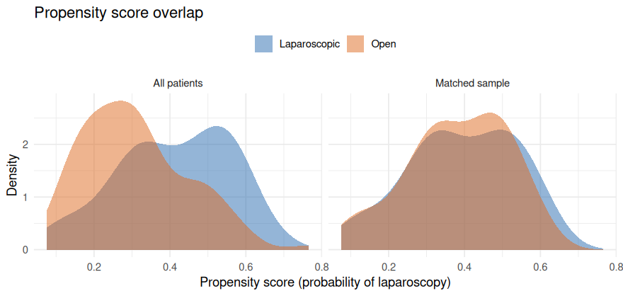

# Propensity score matching: laparoscopic vs open liver resection (R, MatchIt)


[](https://github.com/alex-sukhoi/propensity-score-matching/actions/workflows/reproduce.yml)

Observational surgical data are confounded by indication: surgeons choose laparoscopy for younger,
fitter patients with less extensive disease, so a crude comparison favours laparoscopy unfairly.
This project builds a matched cohort with **1:1 nearest-neighbour propensity score matching
(caliper 0.2)**, checks balance properly, tests the specification, and only then compares outcomes.

> **Data:** synthetic. A registry of 160 liver resections (55 laparoscopic, 105 open) is generated
> in `R/01_simulate_data.R`. The raw export includes a typical coding problem (1 = Yes, 2 = No, plus
> stray 0s) to show the cleaning step.

## Protocol

| Element | Choice |
|---|---|
| Treatment | Laparoscopic (1) vs open (0) resection |
| Matching covariates | Age, ECOG performance status, neoadjuvant chemotherapy, unilobar/bilobar disease |
| Propensity model | Logistic regression; matching on the logit of the PS |
| Algorithm | Nearest neighbour, 1:1, without replacement |
| Caliper | 0.2 SD of the logit PS (Austin, 2011) |
| Balance target | \|SMD\| < 0.10 for every covariate |
| Sensitivity | Caliper 0.3; caliper 0.2 + exact matching on disease extent |

## 1. Data cleaning
The registry codes yes/no as 1/2, but 25 records of `neoadjuvant_chemo` contain **0**. They were
recoded as "No" (natural coding). The assumption is logged in `results/01_recoding_log.csv` so the
data owner can confirm it.

## 2. Matching specifications

| Specification | Matched pairs | Treated matched | Max \|SMD\| after |
|---|---|---|---|
| **NN 1:1, caliper 0.2 (primary)** | **50 / 55** | **90.9%** | **0.090** |
| NN 1:1, caliper 0.3 | 51 / 55 | 92.7% | 0.112 |
| NN 1:1, caliper 0.2 + exact on bilobar | 49 / 55 | 89.1% | 0.165 |

A wider caliper buys one extra pair but loses balance. Forcing exact matching on disease extent
pushes balance off on the other covariates. The 0.2 caliper is the best trade-off.

## 3. Balance

<p align="center"></p>

| Covariate | SMD before | SMD after |
|---|---|---|
| Age | −0.38 | −0.08 |
| Performance status | −0.49 | 0.04 |
| Neoadjuvant chemotherapy | −0.18 | 0.00 |
| Bilobar disease | −0.44 | −0.09 |

Every covariate is balanced after matching (|SMD| < 0.10), and the propensity score distributions
overlap well:

<p align="center"></p>

## 4. Outcomes in the matched cohort (50 pairs)

| Outcome | Laparoscopic | Open | Test | p |
|---|---|---|---|---|
| Length of stay, median days | 6 | 8 | Paired Wilcoxon | < 0.001 |
| 90-day complications | 10% | 28% | McNemar | 0.016 |

After the confounding is removed, laparoscopic resection is still associated with a two-day
shorter stay and fewer 90-day complications. Because the cohort is matched, the tests are for
paired data.

## Repository structure

```
R/01_simulate_data.R   synthetic registry with confounding by indication and coding issues
R/02_matching.R        cleaning, PS model, three matching specs, balance, outcomes, figures
results/               recoding log, SMD tables, specification comparison, outcomes
figures/               love plot, PS overlap
```

## How to run

```r
install.packages(c("MatchIt", "ggplot2"))
source("run_all.R")
```

> The original analysis was done in **SPSS** (*Data → Propensity Score Matching*). This repository
> reproduces the same protocol in R, which makes the balance diagnostics and sensitivity checks
> easier to report.

## References

- Austin, P. C. (2011). Optimal caliper widths for propensity-score matching. *Pharmaceutical Statistics, 10*(2), 150–161.
- Austin, P. C. (2009). Balance diagnostics for comparing the distribution of baseline covariates between treatment groups in propensity-score matched samples. *Statistics in Medicine, 28*(25), 3083–3107.
- Ho, D. E., Imai, K., King, G., & Stuart, E. A. (2011). MatchIt: Nonparametric preprocessing for parametric causal inference. *Journal of Statistical Software, 42*(8), 1–28.
- Stuart, E. A. (2010). Matching methods for causal inference: A review and a look forward. *Statistical Science, 25*(1), 1–21.

---
**Author:** [Oleksii Sukhoi](https://github.com/alex-sukhoi), statistician and data analyst · [LinkedIn](https://www.linkedin.com/in/oleksii-sukhoi-4b60161a7)
